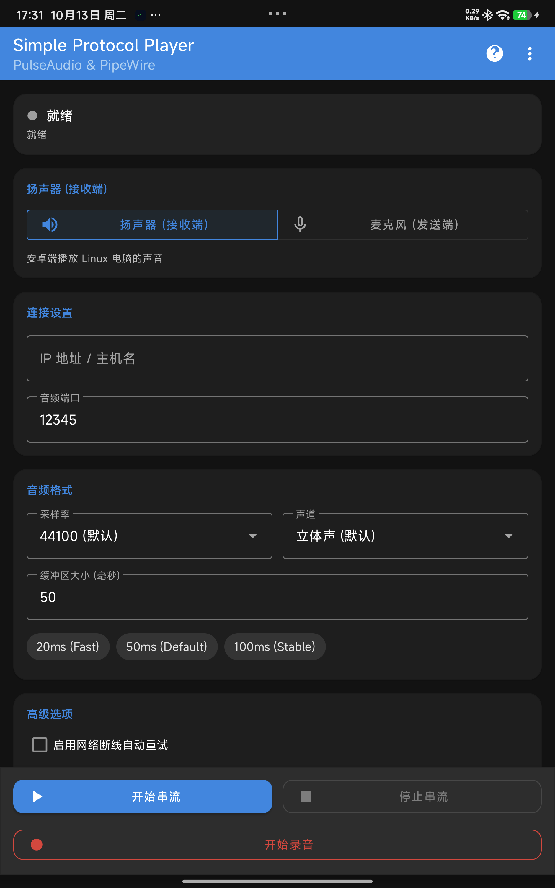

# Simple Protocol Player

<p align="center">
  
</p>

<p align="center">
  <strong>一款基于 PulseAudio / PipeWire simple-protocol-tcp 的低延迟安卓无线音频串流与麦克风工具</strong><br>
  <em>Low-latency wireless audio streaming & microphone player for Android powered by PulseAudio & PipeWire.</em>
</p>

<p align="center">
  <a href="https://github.com/xlzhen-940218/SimpleProtocolPlayer/releases"></a>
  <a href="https://github.com/xlzhen-940218/SimpleProtocolPlayer/blob/master/LICENSE.txt"></a>
  <a href="https://developer.android.com"></a>
  <a href="https://github.com/xlzhen-940218/SimpleProtocolPlayer"></a>
</p>

---

## 📥 下载安装 / Download

> **推荐下载方式**：请前往本仓库的 [**Releases 页面**](https://github.com/xlzhen-940218/SimpleProtocolPlayer/releases) 下载最新版本的 APK 安装包。
> 
> *Recommended: Download the latest APK from the [**Releases Page**](https://github.com/xlzhen-940218/SimpleProtocolPlayer/releases).*

---

## 📱 界面预览 / Screenshot

<p align="center">
  
</p>

---

## ✨ 核心特性 / Key Features

- 🔊 **无线扬声器模式（接收端）**：
  - 将 Linux / PC 电脑的声音以极低延迟无线串流至 Android 手机或平板播放。
  - 支持 44100Hz / 48000Hz 立体声（默认 44100Hz Stereo），可微调 20ms ~ 100ms 缓冲区平衡延迟与稳定性。
- 🎙️ **无线麦克风模式（发送端）**：
  - 将 Android 设备的麦克风采集声音实时通过 TCP 发送至 Linux 电脑作为虚拟麦克风输入（解决 [Issue #43](https://github.com/kaytat/SimpleProtocolPlayer/issues/43)）。
- 🔴 **实时音频录制（WAV 格式）**：
  - 支持在应用主界面或前台通知栏一键启动与停止录音。
  - 音频实时写入系统内部存储 `/Music/` 目录（`内部存储/Music/SPP_Record_*.wav`），保存为无损 16-bit PCM WAV 文件。
  - 适配 Android 10+ Scoped Storage 与媒体库扫描，停止录音后即时 Toast 提示文件路径。
- 🛡️ **常驻前台服务与通知栏控制**：
  - 遵循现代 Android 后台保活规范，杜绝应用退至后台被系统杀进程（解决 [Issue #39](https://github.com/kaytat/SimpleProtocolPlayer/issues/39)）。
  - 通知栏集成状态指示、串流启停以及实时录音控制开关。
- ⚡ **现代化 Material 3 交互与防重复点击**：
  - 彻底解决原始版本播放/停止按钮被连续无限次点击导致 Linux 端加载过多连接模块的隐患。
  - 内置预设延迟快速切换 Chip（20ms 极速、50ms 默认、100ms 稳定）。
- 📋 **内置 Linux 配置向导 & 一键复制**：
  - 内置常用 PulseAudio / PipeWire 加载命令以及 Linux IP 一键查询命令（`hostname -I`）。
  - 支持一键点击复制命令到剪贴板。
- 🌐 **多语言国际化支持（7 种语言）**：
  - 全面支持中文（简体）、英语（English）、德语（Deutsch）、法语（Français）、西班牙语（Español）、韩语（한국어）、日语（日本語）。

---

## 🚀 快速上手 / Quick Start

### 1. 查看 Linux 电脑 IP 地址

在 Linux 终端中运行以下命令查看当前局域网 IP：

```bash
hostname -I
```

---

### 2. Linux 端配置 (PulseAudio / PipeWire)

#### 方案 A：扬声器模式（电脑声音 -> 手机播放）

在 Linux 终端执行以下命令加载 PulseAudio 模块（端口默认为 `12345`，可按需修改）：

```bash
pactl load-module module-simple-protocol-tcp rate=44100 format=s16le channels=2 record=true port=12345
```

> 💡 **命令执行后**：打开 Android App，输入该 Linux 电脑的局域网 IP 和端口 `12345`，选择“扬声器（接收端）”，点击 **开始串流** 即可听到电脑的声音。

---

#### 方案 B：麦克风模式（手机麦克风 -> 电脑输入）

在 Linux 终端执行以下命令加载回放模块：

```bash
pactl load-module module-simple-protocol-tcp rate=44100 format=s16le channels=2 record=false port=12345
```

> 💡 **命令执行后**：打开 Android App，选择“麦克风（发送端）”，点击 **开始串流**，手机麦克风采集的声音将实时发送至 Linux 端。

---

#### 方案 C：使用完毕后卸载模块

在 Linux 终端中卸载模块以释放端口与资源：

```bash
pactl unload-module module-simple-protocol-tcp
```

---

#### 方案 D：PipeWire 永久配置（可选）

如系统使用 PipeWire，可在 `/etc/pipewire/pipewire.conf.d/simple-protocol.conf` 添加以下配置实现开机自动加载：

```conf
context.modules = [
{   name = libpipewire-module-protocol-simple
    args = {
        capture = true
        audio.rate = 44100
        audio.format = S16LE
        audio.channels = 2
        audio.position = [ FL FR ]
        server.address = [
            "tcp:12345"
        ]
    }
}
]
```

---

## ⚙️ 参数建议 / Recommended Settings

| 参数 | 默认值 | 推荐说明 |
| :--- | :--- | :--- |
| **采样率 (Sample Rate)** | `44100 Hz` | 标准 CD 音质，兼顾网络带宽与保真度 |
| **声道 (Channels)** | `Stereo (立体声)` | 享受双声道音频，若网络带宽极低可切换为 Mono (单声道) |
| **缓冲区 (Buffer Size)** | `50 ms` | 综合延迟与防爆音的最佳折中值；低延迟模式可尝试 20ms |
| **端口 (Port)** | `12345` | 需与 Linux 端 `module-simple-protocol-tcp` 的 `port` 参数保持一致 |

---

## 🛠️ 构建与编译 / Build from Source

### 环境要求

- **JDK**：OpenJDK 17 或更高
- **Android SDK**：Compile SDK 36 / Min SDK 26 (Android 8.0+)
- **构建工具**：Gradle 8.13.2 / Android Gradle Plugin 8.13.2

### 编译步骤

```bash
# 克隆仓库
git clone https://github.com/xlzhen-940218/SimpleProtocolPlayer.git
cd SimpleProtocolPlayer

# 编译 Debug APK
./gradlew assembleDebug

# 编译 Release APK
./gradlew assembleRelease
```

编译生成的 APK 文件位于：
`app/build/outputs/apk/debug/app-debug.apk`

---

## 📄 开源许可证 / License

本项目采用 [Apache License 2.0](LICENSE.txt) 许可证。

- 原项目致谢：基于 [kaytat/SimpleProtocolPlayer](https://github.com/kaytat/SimpleProtocolPlayer) 深度重构与功能演进。
